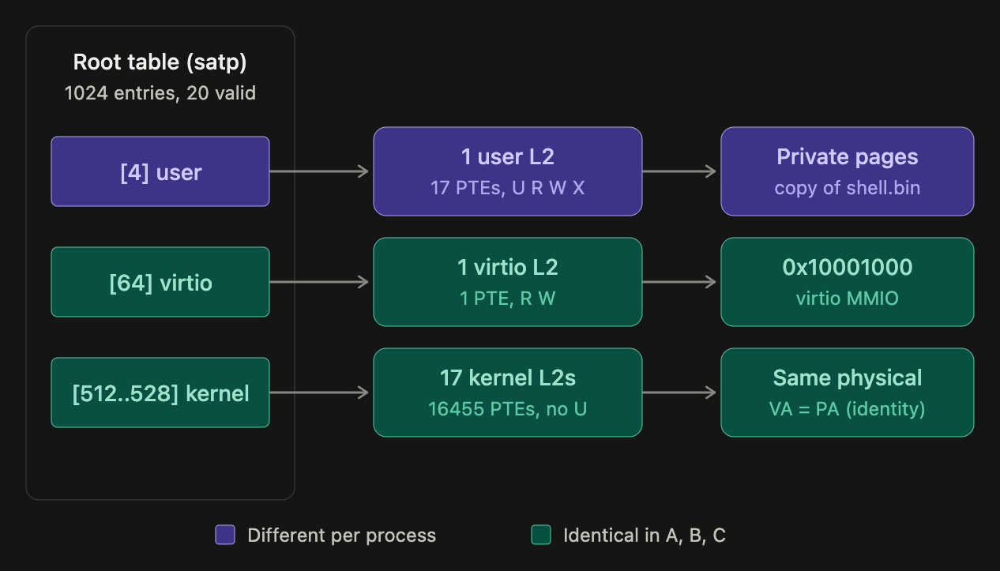

# Page Table

### Why one big table doesn't work ?
The simplest design is a single array: "entry N tells you where virtual page N lives." 
With 32-bit addresses and 4 KB pages, there are 2³² / 2¹² = 2²⁰ = about 1 million virtual pages. 
At 4 bytes per entry, that's a 4 MB table for every process, even for a program that uses only three pages. 
Almost every entry would just say "not mapped."
On 64-bit systems it's far worse. Sv39, which xv6 uses, would need 2²⁷ entries × 8 bytes = 1 GB per process.

### Sv32 virtual address (32 bits):
```text
31                  22 21                  12 11              0
+---------------------+---------------------+-----------------+
|       VPN[1]        |       VPN[0]        |    page offset  |
|       10 bits       |       10 bits       |    12 bits      |
+---------------------+---------------------+-----------------+
      index into           index into           position
      root table           2nd table            inside page
```
Each table has 2¹⁰ = 1024 entries of 4 bytes, so each table is exactly 4 KB, one page.

### What a page table entry looks like
```text
 Sv32 PTE (32 bits):
 
   31                                    10  9                    0
 ┌────────────────────────────────────────┬──────────────────────┐
 │       PPN (physical page number)       │        flags         │
 │                22 bits                 │       10 bits        │
 └────────────────────────────────────────┴──────────────────────┘
 
 ┌──────────────────────────────┬──┬─┬─┬─┬─┬─┬─┬─┬─┐
 │ PPN (physical page number)   │..│D│A│G│U│X│W│R│V│
 │ 22 bits                      │  │ │ │ │ │ │ │ │ │
 └──────────────────────────────┴──┴─┴─┴─┴─┴─┴─┴─┴─┘
                                  bit 0 ────────────┘
                                  
  bit:   9  8   7   6   5   4   3   2   1   0
      ┌───┬───┬───┬───┬───┬───┬───┬───┬───┬───┐
      │RSW│RSW│ D │ A │ G │ U │ X │ W │ R │ V │
      └───┴───┴───┴───┴───┴───┴───┴───┴───┴───┘
                           │   │   │   │   └─ Valid       = 0x001
                           │   │   │   └───── Readable    = 0x002
                           │   │   └───────── Writable    = 0x004
                           │   └───────────── Executable  = 0x008
                           └───────────────── User        = 0x010
```
The most important flags:
- V (valid): is this entry in use? If not, accessing the address causes a page fault, (scause = 12, 13, or 15 exception).
- R / W / X: may this page be read, written, or executed?
- U: may user-mode code access it? Kernel pages leave this off, so user programs can't touch kernel memory.

#### Example:
Translation of `0x01001234`

Step 1: Split the address
```text
0x01001234 in binary:

0000000100 | 0000000001 | 001000110100
└ VPN[1] ┘   └ VPN[0] ┘   └─ offset ─┘
    = 4          = 1         = 0x234
```

Step 2: Walk the tree
```text
satp register
(points to the root table)
    │
    ▼
Root table (level 1)           Level-0 table               Physical memory
┌───────┬──────────────┐       ┌───────┬──────────────┐
│ [0]   │ not valid    │       │ [0]   │ not valid    │
│ [1]   │ not valid    │       │ [1]   │ page 0x80305 │──┐
│ [2]   │ not valid    │       │ [2]   │ page 0x80306 │  │
│ [3]   │ not valid    │       │ ...   │              │  │
│ [4]   │ table ───────┼──────►│ [1023]│ not valid    │  │
│ ...   │              │       └───────┴──────────────┘  │
│ [1023]│ not valid    │                                 │
└───────┴──────────────┘                                 ▼
  index with VPN[1] = 4          index with VPN[0] = 1    page at 0x80305000
                                                           + offset 0x234
                                                           = 0x80305234

Virtual 0x01001234 → Physical 0x80305234
```

#### Example of `map_pages`

1. Set root
`uint32_t *root = (uint32_t *) alloc_pages(1);                     // root table at 0x80221000`
```text
   root @ 0x80221000
 ┌───────┬────────────┐
 │ [0]   │ 0x00000000 │
 │ ...   │ 0x00000000 │   all 1024 entries invalid
 │ [1023]│ 0x00000000 │
 └───────┴────────────┘
```

2. Call 1
```c
map_page(root_table = root, vaddr = 0x01001000, paddr = 0x80305000, flags = PAGE_R | PAGE_W);
```

```text
 vaddr = 0x01001000

 binary:  0000000100 | 0000000001 | 000000000000
          └─ VPN[1] ─┘ └─ VPN[0] ─┘ └─ offset ─┘

 vpn1 = (0x01001000 >> 22) & 0x3ff = 4
 vpn0 = (0x01001000 >> 12) & 0x3ff = 1
 
 new_table = alloc_pages(1)              = 0x80222000
 root[4]   = (0x80222000 / 4096) << 10 | PAGE_V
           = (0x80222 << 10) | 0x1
           = 0x20088800 | 0x1
           = 0x20088801
           
 table0    = (0x20088801 >> 10) * 4096
           = 0x80222 * 4096
           = 0x80222000          ← the table we just allocated ✓
           
 table0[1] = (0x80305000 / 4096) << 10 | 0x6 | 0x1
           = (0x80305 << 10) | 0x7
           = 0x200C1400 | 0x7
           = 0x200C1407
```
<b>State after call 1 </b>
```text

 
    root @ 0x80221000                table @ 0x80222000
 ┌───────┬────────────┐           ┌───────┬────────────┐
 │ [0-3] │ 0          │           │ [0]   │ 0          │
 │ [4]   │ 0x20088801 │──────────►│ [1]   │ 0x200C1407 │──► page 0x80305000 (R W)
 │ [5..] │ 0          │           │ [2..] │ 0          │
 └───────┴────────────┘           └───────┴────────────┘
```

3. Call 2: `map_page(root, 0x01002000, 0x80306000, PAGE_R | PAGE_W);`
```text
    root @ 0x80221000                table @ 0x80222000
 ┌───────┬────────────┐           ┌───────┬────────────┐
 │ [4]   │ 0x20088801 │──────────►│ [1]   │ 0x200C1407 │──► page 0x80305000
 │       │            │           │ [2]   │ 0x200C1807 │──► page 0x80306000
 └───────┴────────────┘           └───────┴────────────┘ 
```

4. Call 3: `map_page(root, 0x80200000, 0x80200000, PAGE_R | PAGE_W | PAGE_X);`


<b>The final tree</b>
```text
 satp ──► root @ 0x80221000
          ┌───────┬────────────┐
          │ [0-3] │ 0          │
          │ [4]   │ 0x20088801 │───┐
          │ ...   │ 0          │   │      table @ 0x80222000
          │ [512] │ 0x20088C01 │─┐ │      ┌───────┬────────────┐
          │ ...   │ 0          │ │ └─────►│ [1]   │ 0x200C1407 │──► 0x80305000  R W
          └───────┴────────────┘ │        │ [2]   │ 0x200C1807 │──► 0x80306000  R W
                                 │        └───────┴────────────┘
                                 │
                                 │        table @ 0x80223000
                                 │        ┌───────┬────────────┐
                                 └───────►│ [512] │ 0x2008000F │──► 0x80200000  R W X
                                          └───────┴────────────┘
```

### Page Table Tree
An example of a process page table tree with 3 process + an idle process.
